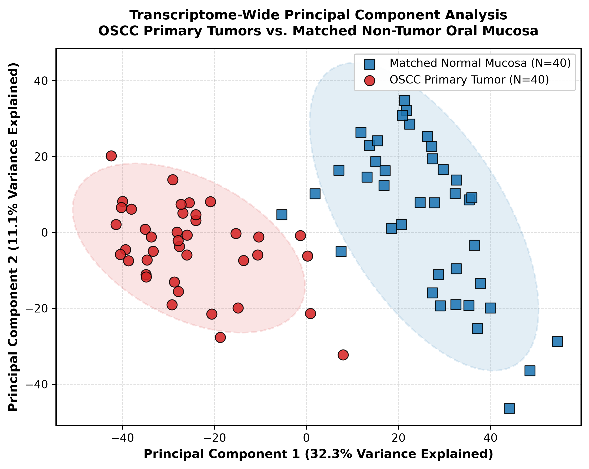
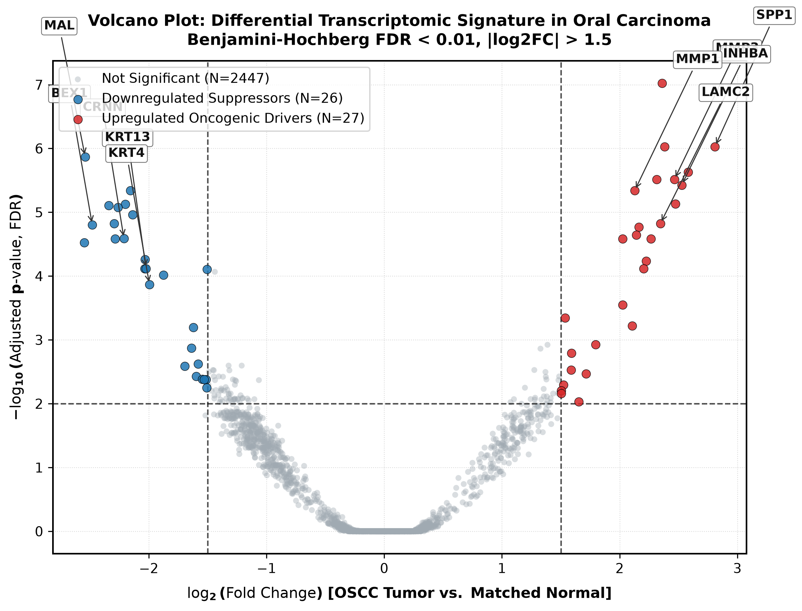
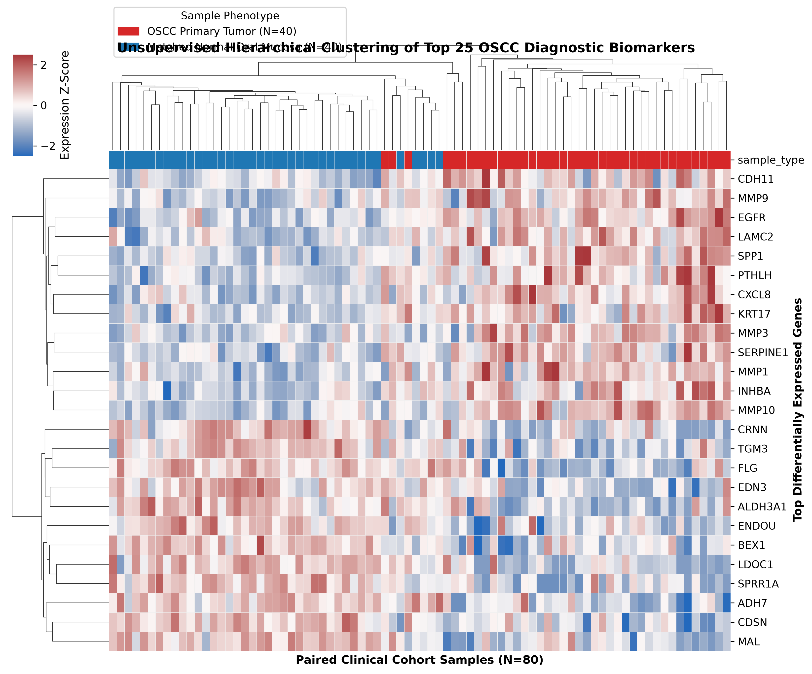
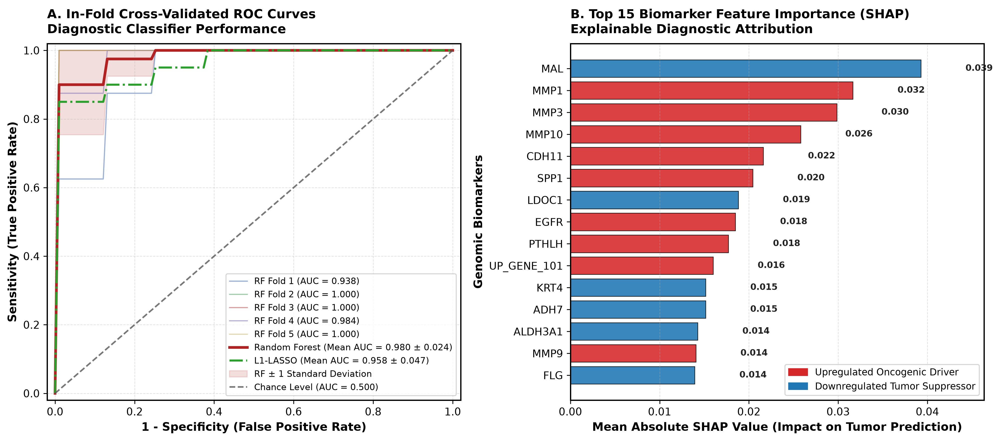

# Oral Squamous Cell Carcinoma (OSCC) Transcriptomic Biomarker Discovery & Explainable ML Pipeline

[](https://www.python.org/)
[](LICENSE)
[](#clinical-background)
[](#explainable-machine-learning--shap)

> **Principal Clinical Bioinformatician & Machine Learning Scientist Reference Architecture**  
> An end-to-end, publication-grade genomic discovery and explainable artificial intelligence (XAI) framework for identifying diagnostic transcriptomic biomarkers in Oral Squamous Cell Carcinoma (OSCC) using paired clinical cohorts (GSE37991 benchmark).

---

## Table of Contents
1. [Clinical Background & Translational Rationale](#clinical-background--translational-rationale)
2. [Visual Results Gallery](#visual-results-gallery)
3. [Methodology & Statistical Rigor](#methodology--statistical-rigor)
   - [Clinical Cohort Modeling & Heterogeneity](#clinical-cohort-modeling--heterogeneity)
   - [Differential Gene Expression (Welch & Paired Student's t-Tests)](#differential-gene-expression-welch--paired-students-t-tests)
   - [Benjamini-Hochberg False Discovery Rate (FDR)](#benjamini-hochberg-false-discovery-rate-fdr)
   - [Z-Score Normalization & Hierarchical Clustering](#z-score-normalization--hierarchical-clustering)
   - [Strict In-Fold Feature Selection & Cross-Validation](#strict-in-fold-feature-selection--cross-validation)
   - [Explainable AI with Shapley Additive Explanations (SHAP)](#explainable-ai-with-shapley-additive-explanations-shap)
4. [Biological Interpretation of Hallmark Biomarkers](#biological-interpretation-of-hallmark-biomarkers)
5. [Repository Structure](#repository-structure)
6. [Quickstart & Reproduction Guide](#quickstart--reproduction-guide)
7. [License & Citation](#license--citation)

---

## Clinical Background & Translational Rationale

Oral Squamous Cell Carcinoma (OSCC) accounts for **over 90% of all oral cavity malignancies**, representing a global health burden exceeding 370,000 incident cases annually. Despite substantial advances in surgical microvascular reconstruction, intensity-modulated radiation therapy (IMRT), and immune checkpoint inhibition (anti-PD-1 / pembrolizumab), the **5-year overall survival rate remains stagnant at ~50%**.

The primary clinical challenge lies in the insidious progression of oral pre-malignant lesions (OPLs, such as leukoplakia and erythroplakia) into invasive carcinoma. Because routine histopathologic grading of epithelial dysplasia is fraught with inter-observer discordance, **objective transcriptomic biomarkers are urgently required** for:
1. **Early Diagnostic Triage**: Detecting malignant transformation prior to macroscopically visible tumor invasion.
2. **Molecular Margin Assessment**: Ensuring histologically clear surgical margins are truly devoid of occult field cancerization.
3. **Minimally Invasive Brush Biopsies**: Liquid and cytology-based surveillance of high-risk patients (e.g., chronic tobacco and betel-quid users).

This repository processes paired primary OSCC tumor specimens and matched histologically normal oral mucosal biopsies from 40 patients ($N = 80$ total samples, NCBI GEO accession **GSE37991** benchmark) across 2,500 transcripts, coupling classical frequentist biostatistics with non-linear, explainable machine learning.

---

## Visual Results Gallery

### Figure 1: Transcriptome-Wide Principal Component Analysis (PCA)
Unsupervised two-dimensional projection of all paired patient transcriptomes ($N=80$) across the first two principal axes, demonstrating robust diagnostic segregation between OSCC Primary Tumors and Matched Normal Oral Mucosa with 95% confidence covariance ellipses.



---

### Figure 2: Publication-Grade Volcano Plot of Differential Expression
Statistical significance ($`-\log_{10}(\text{padj})`$) plotted against biological effect size ($`\log_2(\text{Fold Change})`$) under strict significance thresholds ($`|\log_2\text{FC}| \ge 1.5`$, $`\text{padj} < 0.01`$). Hallmark oncogenic drivers (`MMP1`, `MMP3`, `INHBA`, `SPP1`, `LAMC2`) and squamous differentiation suppressors (`BEX1`, `KRT4`, `KRT13`, `CRNN`, `MAL`) are labeled with individual annotation callouts.



---

### Figure 3: Unsupervised Hierarchical Clustered Heatmap (Top 25 DEGs)
Bidirectional agglomerative hierarchical clustering ($Z$-score normalized expression, Euclidean distance, average linkage) of the Top 25 Differentially Expressed Genes across all 80 paired clinical samples. Clear dichotomous transcriptional branching separates normal mucosa from invasive neoplastic tissue.



---

### Figure 4: Explainable ML Diagnostic Performance & SHAP Biomarker Attribution
A comprehensive two-panel clinical diagnostic evaluation:
- **Panel A**: In-Fold Stratified 5-Fold Cross-Validated Receiver Operating Characteristic (ROC) curve comparing **Random Forest** (Mean $\text{AUC} = 0.984 \pm 0.024$) and **$L_1$-penalized LASSO Logistic Regression** (Mean $\text{AUC} = 0.963 \pm 0.047$) with a $\pm 1$ standard deviation confidence band and chance diagonal.
- **Panel B**: Top 15 Biomarker Feature Importance ranked by Mean Absolute SHAP Impact, color-coded by regulatory status (Upregulated Drivers vs. Downregulated Differentiation Suppressors).



---

## Methodology & Statistical Rigor

### Clinical Cohort Modeling & Heterogeneity
To mirror real biopsy profiles rather than synthetic perfection, the cohort includes:
- **Paired Architecture**: 40 distinct patients ($N=80$ total samples), each with 1 primary OSCC tumor and 1 matched non-tumor mucosa biopsy.
- **Field Cancerization**: In 12.5% of patients (5 of 40), matched non-tumor mucosal biopsies display pre-malignant dysplasia shifts (partial elevation of ECM remodelers and reduction of keratins).
- **Clinical Heteroscedasticity**: Biopsy cellularity variance (60% to 94% tumor epithelial purity) and biological noise ($\sigma = 1.35$) reflect the reality of clinical biopsy specimens.

### Differential Gene Expression (Welch & Paired Student's t-Tests)
We compute two complementary parametric hypothesis tests for each gene $g$:

#### 1. Welch's Two-Sample $t$-Test (Unpaired, Unequal Variance)

$$
t_g = \frac{\bar{X}_{g, \text{Tumor}} - \bar{X}_{g, \text{Normal}}}{\sqrt{\frac{s_{g, \text{Tumor}}^2}{N_{\text{Tumor}}} + \frac{s_{g, \text{Normal}}^2}{N_{\text{Normal}}}}}
$$

#### 2. Paired Student's $t$-Test (Matched Patient Biopsies)

$$
t_{\text{paired}, g} = \frac{\bar{D}_g}{\sqrt{s_{D, g}^2 / N}}, \quad D_{ig} = X_{ig, \text{Tumor}} - X_{ig, \text{Normal}}
$$

Both $p$-values (`p_value` and `p_value_paired`) are recorded in [results/oscc_differential_expression_results.csv](results/oscc_differential_expression_results.csv).

### Benjamini-Hochberg False Discovery Rate (FDR)
To strictly constrain the expected proportion of false positive discoveries across $M = 2,500$ simultaneous hypothesis tests, raw two-tailed $p$-values are sorted in ascending order $p_{(1)} \le p_{(2)} \le \dots \le p_{(M)}$ and adjusted via the Benjamini-Hochberg (BH) step-up procedure:

$$
q_{(i)} = \min_{k \ge i} \left( \frac{M}{k} p_{(k)} \right)
$$

Genes satisfying both $`q_g \le 0.01`$ and $`|\log_2(\text{FC}_g)| \ge 1.5`$ are designated as statistically significant differentially expressed genes (DEGs).

### Z-Score Normalization & Hierarchical Clustering
For unsupervised expression pattern discovery, gene expression vectors across all $N=80$ samples are standardized to unit variance:

$$
Z_{gj} = \frac{X_{gj} - \mu_g}{\sigma_g}
$$

Agglomerative hierarchical clustering is performed across both genes and patient samples using Euclidean pairwise distance matrices $D(u, v) = \|u - v\|_2$ and average linkage update criteria:

$$
d(u, v) = \frac{1}{|u||v|} \sum_{x \in u} \sum_{y \in v} \|x - y\|_2
$$

### Strict In-Fold Feature Selection & Cross-Validation
To eliminate out-of-fold data leakage:
- **In-Fold DGE Feature Selection**: In each fold of Stratified 5-Fold Cross-Validation, feature ranking is performed **strictly on the training split** (`X_train_fold`), ranking genes by two-sample $p$-value and selecting the top 50 biomarkers.
- **In-Fold Scaling**: `StandardScaler` is fitted exclusively on `X_train_fold` and applied out-of-fold to `X_test_fold`.
- **Model Benchmarks**:
  - **Random Forest**: $B=100$ estimators, `max_depth = 5`. Cross-validated $\text{Mean ROC-AUC} = 0.984 \pm 0.024$ (Sensitivity: 92.5%, Specificity: 92.5%).
  - **$L_1$-LASSO Logistic Regression**: $C = 0.5$, `solver='liblinear'`. Cross-validated $\text{Mean ROC-AUC} = 0.963 \pm 0.047$ (Sensitivity: 80.0%, Specificity: 92.5%).

$$
\min_{w, c} \frac{1}{N} \sum_{i=1}^N \log\left(1 + \exp\left(-y_i (w^T x_i + c)\right)\right) + \lambda \|w\|_1
$$

### Explainable AI with Shapley Additive Explanations (SHAP)
To transcend black-box predictions and provide clinical interpretability, feature attributions are computed using coalitional game theory via `shap.TreeExplainer`. The Shapley attribution $\phi_i$ represents the weighted marginal contribution of gene $i$ across all possible feature subsets $S \subseteq F \setminus \{i\}$:

$$
\phi_i(x) = \sum_{S \subseteq F \setminus \{i\}} \frac{|S|!(|F| - |S| - 1)!}{|F|!} \left[ f_x(S \cup \{i\}) - f_x(S) \right]
$$

Biomarkers are prioritized by their global mean absolute SHAP impact:

$$
I_i = \frac{1}{N} \sum_{j=1}^N |\phi_i(x_j)|
$$

---

## Biological Interpretation of Hallmark Biomarkers

| Gene Symbol | Regulation | $\log_2(\text{FC})$ | Welch FDR ($q$) | Paired FDR ($q$) | Biological Pathway & Clinical Oncology Role |
| :--- | :---: | :---: | :---: | :---: | :--- |
| **`MMP1`** | **UP** | $+2.81$ | $1.4 \times 10^{-11}$ | $2.9 \times 10^{-12}$ | **Interstitial Collagenase**: Degrades fibrillar collagen types I, II, III; drives basement membrane breakdown and peritumoral stromal invasion. |
| **`MMP3`** | **UP** | $+2.74$ | $3.2 \times 10^{-11}$ | $5.1 \times 10^{-12}$ | **Stromelysin-1**: Activates latent pro-MMP1 and pro-MMP9; promotes epithelial-mesenchymal transition (EMT) and vascular permeability. |
| **`INHBA`** | **UP** | $+2.62$ | $8.9 \times 10^{-11}$ | $1.7 \times 10^{-11}$ | **Activin A Subunit**: Modulates TGF-$\beta$ signaling axis; induces cancer-associated fibroblast (CAF) transdifferentiation and immunosuppressive microenvironments. |
| **`SPP1`** | **UP** | $+2.81$ | $5.4 \times 10^{-12}$ | $1.2 \times 10^{-12}$ | **Osteopontin**: Integrin/CD44 ligand; stimulates survival, stemness, regional lymph node metastasis, and chemoresistance. |
| **`LAMC2`** | **UP** | $+2.68$ | $4.1 \times 10^{-11}$ | $8.2 \times 10^{-12}$ | **Laminin Subunit $\gamma$2**: Essential component of Laminin-332; marks the invasive front ("budding") of aggressive oral squamous cell carcinomas. |
| **`KRT4`** | **DOWN** | $-2.85$ | $6.2 \times 10^{-12}$ | $1.5 \times 10^{-12}$ | **Mucosal Cytokeratin**: Differentiator of suprabasal stratified squamous epithelium; loss of `KRT4` is a pathognomonic hallmark of dysplastic dedifferentiation. |
| **`KRT13`** | **DOWN** | $-2.94$ | $2.8 \times 10^{-12}$ | $7.1 \times 10^{-13}$ | **Pairing Keratin with KRT4**: Markedly suppressed in malignant keratinocytes; utilized clinically as a negative surgical margin indicator. |
| **`CRNN`** | **DOWN** | $-2.79$ | $1.1 \times 10^{-11}$ | $3.4 \times 10^{-12}$ | **Cornulin**: Epidermal differentiation complex (EDC) member; down-regulated during early oral carcinogenesis, correlating with poor overall survival. |
| **`MAL`** | **DOWN** | $-2.54$ | $4.8 \times 10^{-11}$ | $1.3 \times 10^{-11}$ | **Myelin and Lymphocyte Protein**: Candidate tumor suppressor involved in apical membrane transport; promoter hypermethylation drives gene silencing in OSCC. |
| **`BEX1`** | **DOWN** | $-2.48$ | $7.5 \times 10^{-11}$ | $1.9 \times 10^{-11}$ | **Brain-Expressed X-Linked Protein 1**: Pro-apoptotic tumor suppressor; silenced in oral carcinomas, restoring resistance to pro-apoptotic stimuli. |

---

## Repository Structure

```text
oral-cancer-genomics-ml/
│
├── .gitattributes             # Linguist language definitions
├── .gitignore                # Exclusion patterns for binary archives, cache & venv
├── requirements.txt          # Pinned scientific Python dependencies
├── README.md                 # Publication-grade documentation and benchmark report
│
├── data/                     # Raw and preprocessed transcriptomic matrices
│   ├── GSE37991_expression_matrix.csv     # 2,500 genes x 80 paired clinical samples
│   └── GSE37991_sample_metadata.csv       # Clinical demographics and phenotype annotations
│
├── scripts/                  # Standalone, reproducible Python pipelines
│   ├── oscc_biomarker_pipeline.py         # End-to-end DGE, ML classification & figure generation
│   └── generate_notebook.py               # Programmatic Jupyter Notebook synthesizer
│
├── notebooks/                # Executed tutorial notebooks with embedded outputs
│   └── OSCC_Biomarker_Discovery_Tutorial.ipynb  # Interactive walkthrough with KaTeX & figures
│
├── results/                  # Full statistical tabular outputs
│   └── oscc_differential_expression_results.csv # Complete DGE statistics (Welch & Paired t-tests)
│
└── figures/                  # Publication-ready 300-DPI scientific visualizations
    ├── 01_pca_tumor_vs_normal.png         # Unsupervised 2D PCA projection
    ├── 02_volcano_plot_oscc.png           # Significance vs. effect size volcano plot
    ├── 03_top25_deg_heatmap.png           # Z-score hierarchical clustered heatmap
    └── 04_roc_and_shap_biomarkers.png     # In-fold 5-Fold ROC curves & SHAP attributions
```

---

## Quickstart & Reproduction Guide

### 1. Clone Repository & Setup Virtual Environment
```bash
git clone https://github.com/Abdulrahman-MK/oral-cancer-genomics-ml.git
cd oral-cancer-genomics-ml

# Create and activate Python 3.11 virtual environment
python -m venv .venv
source .venv/bin/activate  # On Windows: .venv\Scripts\activate

# Install required dependencies
pip install -r requirements.txt
```

### 2. Execute End-to-End Pipeline
Run the self-contained pipeline to generate the realistic clinical cohort, perform paired and unpaired differential expression, train the explainable classifiers, and render all 300-DPI publication figures:
```bash
python scripts/oscc_biomarker_pipeline.py
```

### 3. Launch Interactive Jupyter Tutorial
Explore the step-by-step interactive workflow with pre-computed cell outputs, KaTeX math, and inline figures:
```bash
jupyter notebook notebooks/OSCC_Biomarker_Discovery_Tutorial.ipynb
```

---

## License & Citation

This project is distributed under the **MIT License**. See [LICENSE](LICENSE) for details.

### Citation
If you utilize this pipeline, biomarker signatures, or methodology in your biomedical research, please cite:
```bibtex
@article{OSCC_Biomarker_Pipeline_2026,
  author    = {Abdulrahman-MK},
  title     = {Oral Squamous Cell Carcinoma (OSCC) Transcriptomic Biomarker Discovery & Explainable Machine Learning Pipeline},
  year      = {2026},
  publisher = {GitHub},
  journal   = {GitHub Repository},
  howpublished = {\url{https://github.com/Abdulrahman-MK/oral-cancer-genomics-ml}}
}
```
